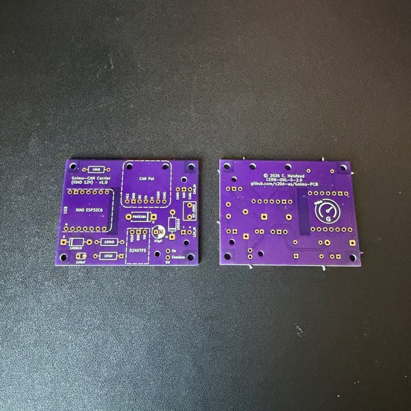
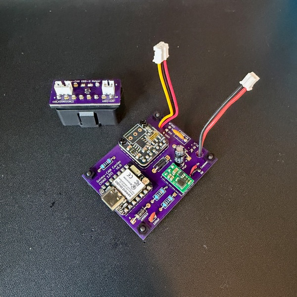
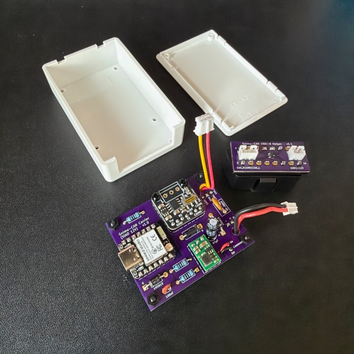
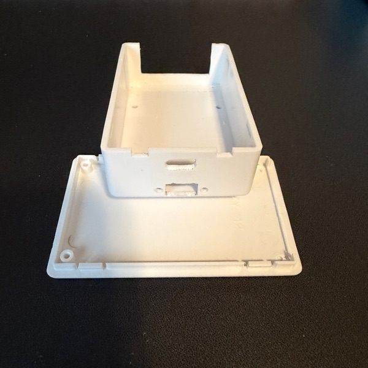
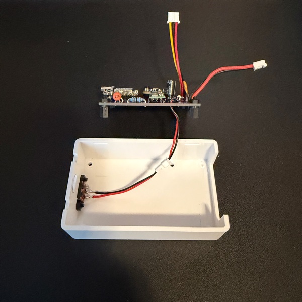
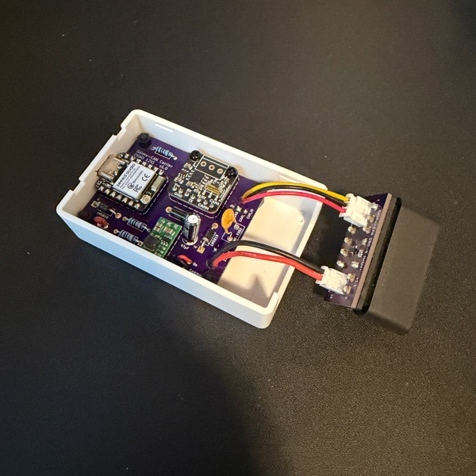
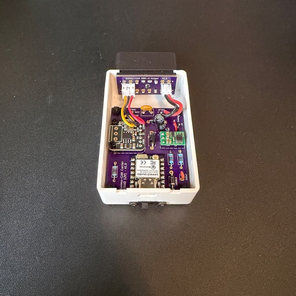

# Assembling the 12V device

This page walks through fitting a loaded [Gnimu-CAN 12V carrier](https://github.com/c20d-us/Gnimu-PCB/tree/main/boards/gnimu-can/gnimu-can-carrier-xiao-12v-v1.0) and an [OBD-II helper](https://github.com/c20d-us/Gnimu-PCB/tree/main/boards/gnimu-can/gnimu-can-obd-helper-v1.1) on its J1962 plug into an ABS project box with a power switch, to make a finished unit that plugs straight into the car's OBD-II port.

> [!WARNING]
> This device connects to your car's diagnostic port and transmits on its CAN bus. Read [Use at your own risk](../README.md#use-at-your-own-risk) before you build or use one.

---

## What you need

- A loaded **12V carrier** (v1.0): XIAO ESP32C6, Adafruit CAN Pal, Pololu D24V7F5 regulator, and the fuse, diodes, capacitors and resistors. The parts list and assembly notes are in the [carrier's README](https://github.com/c20d-us/Gnimu-PCB/tree/main/boards/gnimu-can/gnimu-can-carrier-xiao-12v-v1.0#parts).
- An **OBD-II helper** (v1.1) soldered onto a straight-pin J1962 plug. See the [helper's README](https://github.com/c20d-us/Gnimu-PCB/tree/main/boards/gnimu-can/gnimu-can-obd-helper-v1.1).
- **JST PH pigtails** soldered to the carrier: a 3-wire lead on J1 (CAN) and a red/black 2-wire lead on J2 (12V).
- An ABS [project box](https://www.amazon.com/dp/B0BQYPKRQS), 80x50x26 mm exterior, 75x45x22 mm interior.
- A latching [slide switch](https://www.amazon.com/dp/B0BWMS64PR) with a mounting flange, and a short JST lead to join it to the carrier's J3.
- 4x M2.5 hex standoffs, screws, and washers to mount the carrier. I used 6mm standoffs plus a 1mm washer, which elevates the PCB ~7mm off the bottom of the box, leaving plenty of room for the switch to be placed underneath on the USB end. Using 10mm standoffs would raise the PCB too high - the top of the 47µF capacitor would be higher than the top edge of the box and the lid would not close.
- Drill press and bits, small file or chisel, rotary tool or sharp hobby knife for the openings.

<table>
  <tr>
    <td align="center" valign="top" width="50%">
       
      The bare 12V carrier, front and back.
    </td>
    <td align="center" valign="top" width="50%">
       
      The loaded carrier on its standoffs, with the CAN and 12V pigtails, beside the OBD-II helper on its plug. The switch leads (J3) exit on the underside of the board.
    </td>
  </tr>
</table>

---

## 1. Prepare the box

### 1.1 Clear the interior and drill the standoff holes

Holes for the carrier's four corner standoffs need to be drilled in the bottom of the box. Cut away the box's existing standoff bosses with a sharp chisel and shave away any remaining material so that the bottom is flat. Drill the holes for the PCB standoffs from the inside, using a bare PCB as a guide. The [Gnimu enclosure guide](https://github.com/c20d-us/Gnimu/blob/main/docs/build-pcb-enclosure.md#12-drill-the-standoff-holes) shows similar steps with photos.

### 1.2 Cut the J1962 opening

<table>
  <tr>
    <td valign="top" width="320">
      
    </td>
    <td valign="top">
        The OBD-II plug sits in one end of the box, with the helper board inside and the plug's mating face outside. Use the box end <b>without</b> the lid removal cutouts. Cut that end wall away from the top edge down, wide enough for the plug's body to drop in. Use the plug itself to mark the edges, and take the plastic off a little at a time, checking the fit as you go. The top edge of the plug flange should end up flush with the top edge of the box.  
        Notch the lid's flange to match, so the lid closes down over the plug and holds it in place. If you'd like the plug to be extra secure, you can glue the J1962 plug to the end wall. I've found this generally unnecessary as the plug holds well once the lid is on.
    </td>
  </tr>
</table>

---

## 2. Cut the USB and switch openings

<table>
  <tr>
    <td valign="top" width="320">
      
    </td>
    <td valign="top">
        The other end of the box gets two openings: a slot for the XIAO's USB-C port, and below it, a rectangular opening for the switch body with a screw hole on each side.  
        <b>USB-C slot:</b> fit the carrier on its standoffs to find where the USB-C port lands, then drill a starter hole and open it out into a slot with a knife or file. It only needs to be big enough for a cable's plug to reach the port.  
        <b>Switch opening:</b> drill a starter hole with its bottom edge at the floor of the box, then open it out to a rectangle that the switch body just fits through. Fit the switch into the opening and drill through its mounting holes to make openings for the hold-down screws.
    </td>
  </tr>
</table>

---

## 3. Install the hardware

<table>
  <tr>
    <td valign="top" width="320">
      
    </td>
    <td valign="top">
        Fasten the switch to the end wall with M2.5 screws and nuts. Its lead ends in a JST plug that mates with the lead from the carrier's J3 pads, which comes out of the underside of the board.  
        <b>No switch?</b> J3 can be bridged with a wire link, or fitted with a 2-pin header and a jumper. The switch is still the easiest way to turn the device off in the car. The sleep function isn't meant to look after the battery long-term.
    </td>
  </tr>
</table>

---

## 4. Install the carrier and the plug

### 4.1 Connect the switch and fit the carrier

<table>
  <tr>
    <td valign="top" width="320">
      
    </td>
    <td valign="top">
        Set the switch to off and plug the switch lead into the carrier's J3 lead. Tuck the wires in and settle the carrier into the box, with the USB-C port at the slot. Make sure nothing is pinched, then fasten each corner with an M2.5 screw from udnerneath.  
        Plug the carrier's leads into the helper: the 3-wire CAN lead into the helper's <code>CAN_H | GND | CAN_L</code> socket, and the red/black lead into its <code>GND | +12V</code> socket. Both are keyed.
    </td>
  </tr>
</table>

### 4.2 Seat the plug and close the box

<table>
  <tr>
    <td valign="top" width="320">
      
    </td>
    <td valign="top">
        Drop the plug into its opening, with the helper board inside the box. Fold the leads so they sit below the lid line, clear of the CAN Pal and the regulator.  
        <b>Before you close it,</b> check that the CAN Pal's termination switch is <b>off</b>. A car's bus is already terminated, and the switch can't be reached once the lid is on.  
        Attach the lid, making sure you don't pinch any wires.
    </td>
  </tr>
</table>

---

## Before it goes in the car

- **Flash and check it on the bench first.** Follow [Build and flash](../README.md#build-and-flash), then the bench steps in [First car test](car-test.md#before-the-car-on-the-bench), including the supply calibration. Each board's voltage reading needs its own `kSupplyCalibration`.
- **Connecting a laptop in the car:** plug the device in with the switch off, plug in the laptop's USB-C cable, then switch it on. A USB-C laptop may not connect to a board that's already powered.
- **When you're done for the day:** switch it off or unplug it.

### Status LED

| Pattern | Meaning |
|---|---|
| Off | Switched off, starting up, or asleep. |
| Short flash every 2 s | Waiting for the vehicle: no ECU found yet. |
| Slow blink, 1 s on, 1 s off | Polling the ECU, no app connected. |
| Solid | Polling the ECU, an app is connected. |
| Fast blink | Fault: CAN or BLE failed to start. Check the boot log. |
